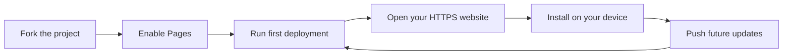

  
  <h1>Kirana POS</h1>
  
A simple point-of-sale and store-management app for kirana shops.

  

    
    
    
  

Kirana POS runs in your web browser and can be installed on a computer or phone like an app. No app-store account or software installation is needed.

## What you can do

| Area | Features |
| --- | --- |
| 🧾 **Billing** | Create sales invoices and record payments. |
| 📦 **Inventory** | Track products, purchases, and stock adjustments. |
| 👥 **Store accounts** | Manage customer balances, suppliers, and payments. |
| 📊 **Reports** | Review sales, expenses, and business summaries. |

## Get started

### Option 1: Open the published app

If the repository owner has enabled GitHub Pages, open the live app link they shared. You can then install it by following the instructions below.

> **Can't find a live link?** Ask the repository owner to publish the app using the steps in [Publish your own copy](#https://code-me-nik.github.io/kirana-pos/).

### Option 2: Run it on your computer

1. Download or clone this repository to your computer.
2. Open the downloaded project folder.
3. Double-click `index.html` to try the app in your browser.

Opening the file directly is useful for trying the app, but installing it and using it offline require a secure website address (HTTPS) or a local web server. The published GitHub Pages website uses HTTPS.

## Install the app

First, open the app's **HTTPS website** in the browser you want to use. The exact menu wording can vary slightly by browser version.

  
<strong>Chrome on a computer</strong>

1. Open the app website in Chrome.
2. Select **Install app** in the app header if it is shown. Otherwise, open the **⋮** menu and choose **Install page as app** or **Save and share → Install page as app**.
3. Confirm by selecting **Install**.
4. Open Kirana POS from your desktop, app launcher, or Chrome apps.

  
<strong>Microsoft Edge on a computer</strong>

1. Open the app website in Edge.
2. Select **Install app** in the app header if it is shown. Alternatively, open **… → Apps → Install this site as an app**.
3. Confirm the installation.
4. Open Kirana POS from your Start menu or app launcher.

  
<strong>Android phone or tablet</strong>

1. Open the app website in Chrome.
2. Tap **Install app** if it is shown. If not, tap **⋮ → Install app** or **Add to Home screen**.
3. Follow the confirmation prompt.
4. Tap the Kirana POS icon on your home screen to open it.

  
<strong>iPhone or iPad</strong>

1. Open the app website in Safari.
2. Tap the **Share** button.
3. Scroll down and tap **Add to Home Screen**. If offered, turn on **Open as Web App**.
4. Tap **Add**, then open Kirana POS from your home screen.

If you don't see an install option, check that you are using the HTTPS website, try one of the supported browsers above, and reload the page while online.

## Publish your own copy on GitHub Pages

This repository already includes a workflow that publishes the site whenever changes are pushed to the `main` branch.

### 1. Create your own repository

The easiest way to get your own copy is to fork this repository:

1. Sign in to GitHub and open [Code-me-nik/kirana-pos](https://github.com/Code-me-nik/kirana-pos).
2. Select **Fork → Create fork**. This creates a separate copy under your GitHub account.
3. Open your new fork and select **Settings → Pages**.
4. Under **Build and deployment**, set **Source** to **GitHub Actions**.

### 2. Run the first deployment

1. In your fork, select the **Actions** tab. If GitHub asks, enable the repository's workflows.
2. Select **Deploy to GitHub Pages** from the workflow list.
3. Select **Run workflow**, choose the `main` branch, then select **Run workflow** again.
4. Wait for the workflow run to finish successfully.
5. Open **Settings → Pages** or the completed workflow run to find the website link. It will look like `https://YOUR-USERNAME.github.io/kirana-pos/`.

### 3. Publish future updates

To edit your copy on your computer, use [GitHub Desktop](https://desktop.github.com/):

1. Install GitHub Desktop and sign in to GitHub.
2. Select **File → Clone repository…**, choose **URL**, and enter the URL of **your fork** (not the original repository). Alternatively, select your fork from the GitHub.com list.
3. After making changes, enter a short summary in the **Changes** tab and select **Commit to main**.
4. Select **Push origin**. GitHub Actions will publish the update automatically.
5. Follow the deployment in your repository's **Actions** tab.

> **Important:** Keep the `.github/workflows/pages.yml` file in your repository. It is inside the hidden `.github` folder and is what automates publishing.

The app's web manifest and service worker use relative paths, so the website also works at the subpath used by project repositories on GitHub Pages.

## Use the app offline

Open the published app once while connected to the internet. The browser then saves the app shell so it can reopen when you are offline. Some features that depend on internet-loaded resources, such as charts, may not be available without a connection.

## Important: where your business data is stored

- Products, sales, and other records are saved **in the browser on the device where you use the app**.
- Your records are **not uploaded to GitHub**, sent to a server, or automatically synchronized to other devices.
- Clearing the browser's site data or losing the device can remove your records.
- Select **Backup** in the app regularly and save the exported JSON backup somewhere safe. Use **Import** to restore a backup.

## Troubleshooting

| Problem | What to try |
| --- | --- |
| The website does not open | Confirm that the GitHub Pages deployment completed successfully in **Actions**. |
| No install option appears | Open the HTTPS website in Chrome, Edge, or Safari on iPhone/iPad; then reload while online. |
| The app does not open offline | Visit it once while online, then try again. The first visit is needed to cache the app shell. |
| Your data is missing on another device | Data is stored separately in each browser. Restore a backup on the other device if you have one. |

## For developers

This project is a static website; it has no build step or package installation. The main files are:

- `index.html` — the application.
- `manifest.webmanifest` — the installable app's name, appearance, and icons.
- `service-worker.js` — offline app-shell caching.
- `.github/workflows/pages.yml` — automated GitHub Pages deployment.
